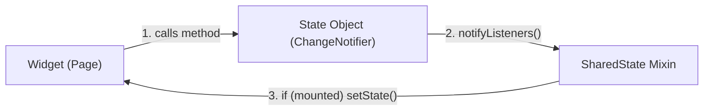

# Flutter Shared State


[](https://github.com/carllosnc/flutter_shared_state/actions/workflows/dart.yml)

> A simple way to share state between widgets using ChangeNotifier and Mixins without external dependencies.

**ChangeNotifier:** A Flutter class that provides change notifications to its listeners.

**Mixin:** A way of reusing class code across multiple class hierarchies.

## Goals

- **Shareable**: Easily accessible across multiple widgets.
- **Isolated**: State contains no UI dependencies or BuildContext.
- **Testable**: Simple unit testing for pure business logic.
- **Reusable**: Plug into any widget state with a single mixin.
- **Zero Dependencies**: Relies exclusively on Dart and Flutter core APIs.
- **Controlled**: Explicit mutations and side-effect handling.

## Architecture Flow



## Examples

- [Counter](lib/modules/counter): Basic synchronous counter with split widgets.
- [Todo List](lib/modules/todo_list): In-memory task management.
- [Async Todo List](lib/modules/async_todo_list): Simulated asynchronous calls with loading states.
- [Todo List with SQLite](lib/modules/sqlite): Local persistent storage using SQLite.

## Trade-offs

| Advantages | Considerations |
| :--- | :--- |
| Zero external state management packages needed | Entire widget subtree rebuilds on change (no granular selector) |
| State classes are pure and isolated from BuildContext | Global state instances persist for the application lifecycle |
| Low cognitive load and minimal boilerplate | For very large apps, scoped dependency injection might be preferred |

## Getting Started

### Prerequisites

- Flutter SDK (stable channel)
- Dart SDK 3.x or higher

### Running the Project

Clone the repository:

```bash
git clone https://github.com/carllosnc/flutter_shared_state.git
cd flutter_shared_state
```

Install dependencies:

```bash
flutter pub get
```

Run the application:

```bash
flutter run
```

Run tests and analysis:

```bash
flutter test
flutter analyze
```

## How It Works

### 01. Creating the Mixin (State Container)

The mixin acts as the central state registry, listening to state notifications and rebuilding the widget:

```dart
import 'package:flutter/material.dart';
import '/modules/counter/counter_state.dart';
import '/modules/todo_list/todo_list_state.dart';
import '/modules/async_todo_list/async_todo_list_state.dart';
import '/modules/sqlite/database.dart';

mixin SharedState<T extends StatefulWidget> on State<T> {
  @override
  void initState() {
    super.initState();
    counter.addListener(action);
    todoList.addListener(action);
    asyncTodoList.addListener(action);
    database.addListener(action);
  }

  @override
  void dispose() {
    super.dispose();
    counter.removeListener(action);
    todoList.removeListener(action);
    asyncTodoList.removeListener(action);
    database.removeListener(action);
  }

  void action() {
    if (mounted) {
      setState(() {});
    }
  }
}
```

### 02. Creating the State Object

State objects extend `ChangeNotifier` and manage internal data:

```dart
import 'package:flutter/material.dart';

class _Counter extends ChangeNotifier {
  int value = 0;

  void increment() {
    value++;
    notifyListeners();
  }

  void decrement() {
    value--;
    notifyListeners();
  }
}

var counter = _Counter();
```

### 03. Consuming State with SharedState

Apply the `SharedState` mixin to any `StatefulWidget`:

```dart
import 'package:flutter/material.dart';
import 'package:flutter_shared_state/shared_state.dart';

class CounterPage extends StatefulWidget {
  const CounterPage({super.key});

  @override
  State<CounterPage> createState() => _CounterPageState();
}

class _CounterPageState extends State<CounterPage> with SharedState {
  @override
  Widget build(BuildContext context) {
    return Scaffold(
      appBar: AppBar(
        title: const Text('Counter'),
      ),
      body: Center(
        child: FilledButton(
          onPressed: counter.increment,
          child: Text('Increment ${counter.value}'),
        ),
      ),
    );
  }
}
```

### 04. Testing State Objects

Because state logic is decoupled from widgets and `BuildContext`, it can be verified via pure unit tests:

```dart
import 'package:flutter_test/flutter_test.dart';
import 'package:flutter_shared_state/modules/counter/counter_state.dart';

void main() {
  test('check counter state', () {
    expect(counter.value, 0);
    counter.increment();
    expect(counter.value, 1);
    counter.decrement();
    expect(counter.value, 0);
  });
}
```

## AI Agent Guidelines

This repository includes an [AGENT.md](AGENT.md) specification file with architectural boundaries, guardrails, and conventions for AI assistants such as Antigravity, Cursor, Claude Code, and GitHub Copilot.
